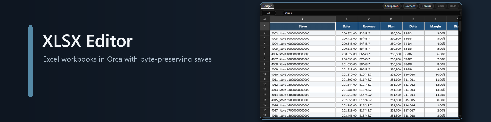
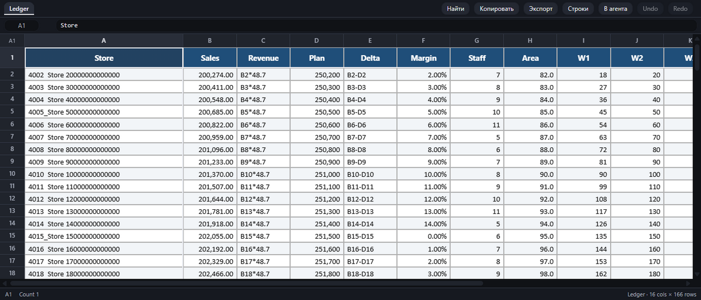

<div align="center">

[Русская версия](README.md)



<p>
  <a href="https://github.com/narimanisakhanov-creator/orca-xlsx-editor/releases/latest"></a>
  <a href="LICENSE"></a>
  
  
  
</p>

<p><b>An Excel workbook editor for Orca: file-native formatting, focused cell edits and untouched ZIP parts preserved on save.</b></p>

<p>
  <a href="#installation">Installation</a> ·
  <a href="#capabilities">Capabilities</a> ·
  <a href="#hand-off-to-an-agent">Hand-off to an agent</a> ·
  <a href="#how-saving-works">How saving works</a> ·
  <a href="#limitations">Limitations</a> ·
  <a href="#development">Development</a> ·
  <a href="#changes">Changes</a>
</p>

</div>

---



<p align="center"><sub>A real Orca capture from the synthetic workbook <code>test/fixtures/styled.xlsx</code>; see <a href="docs/screenshots.md">docs/screenshots.md</a> for how it was produced.</sub></p>

## Installation

**From Git.** Open this link in Orca:

<a href="orca://plugins/narimanisakhanov-creator.xlsx-editor?catalog=https://github.com/narimanisakhanov-creator/orca-xlsx-editor.git">Install from Git</a>

**Development mode.** From the root of a cloned repository, run:

```sh
orca plugin dev load .
```

Requires Orca `>=1.4.248`. Node.js `>=20.6` is required for builds and tests.

## Capabilities

- Opens `.xlsx` and `.xlsm` workbooks, including every sheet.
- Draws fills, fonts, borders, alignment, number formats, merged cells, frozen panes, column widths and row heights.
- Edits cell values and types, with formulas, clearing, block paste, undo and redo.
- Copies a selection as TSV, CSV or Markdown and exports a complete sheet.
- Hands the table to an agent's terminal in Orca — with a preview of exactly what will be sent.
- Leaves macros, drawings, charts and pivot caches untouched on save; objects the editor does not draw still survive.
- Works locally without network access.

## Hand-off to an agent

The **В агента** button in the editor toolbar turns the selection (or the sheet) into a Markdown
table or TSV and types it into the terminal of a chosen agent in the current workspace. Nothing is
sent without a press; by default the text is inserted **without** Enter so it can be read and
extended, and the "Send immediately" checkbox adds Enter.

The preview shows exactly the text that will leave the plugin, because the same function builds both.
One message is capped at 4096 characters (Orca's limit on `terminal.sendText`); longer text is cut on
a line boundary and the reply says so.

For this the plugin runs in the `trusted-worker` profile and asks for two capabilities when enabled:
`agent:read` to see the workspace's agents, and `terminal:send` to type into one terminal. It reads
and launches nothing else.

## How saving works

An Excel workbook is a ZIP of XML parts; the editor changes only `<c>` elements in the XML of sheets that were edited. Untouched ZIP entries retain their original compressed bytes, while text values are written inline so `sharedStrings.xml` is not rewritten. Macros and every other untouched part remain byte-for-byte unchanged. When a cell actually changes and the workbook carries `calcChain.xml`, the chain is removed, relationships are updated, and `fullCalcOnLoad="1"` asks Excel to recalculate; a save with no cell changes leaves this bookkeeping untouched.

## Limitations

- Charts, pivot tables, sparklines and other drawing objects are not rendered; they remain in the workbook on save.
- Formulas are not evaluated: the editor shows the cached result or formula text, and an edited formula is left for Excel to recalculate on open.
- Inserting or deleting rows and columns is not supported.
- Only `.xlsx` and `.xlsm` are supported; `.xls`, `.xlsb` and `.ods` are not.
- On a real machine, 6 of 478 workbooks fail to open: ExcelJS fails on a part with an unprefixed `<wsDr>`, on a table part and on prefixed namespaces.
- There is no network access: the editor does not load external resources.
- The hand-off works in the desktop app only: in the browser client the frame has no worker.

## Development

```sh
npm ci
npm run build
npm test
npm run check:dist
orca plugin validate .
orca plugin check .
orca plugin test .
```

In the current repository snapshot, `npm test` reports 168 passing tests. `npm run build` creates `editor/assets/` and checks the resulting distribution; `check:dist` repeats those checks without writing. `orca plugin validate`, `check` and `test` run Orca's manifest, package and test checks.

The `orca-catalog.json` catalog is regenerated with `node scripts/write-catalog.mjs` after a build and before the release commit.

## Changes

- [Changelog](CHANGELOG.md)
- [MIT license](LICENSE)
- [Third-party notices](THIRD_PARTY_NOTICES.md)
- [Русская версия](README.md)
