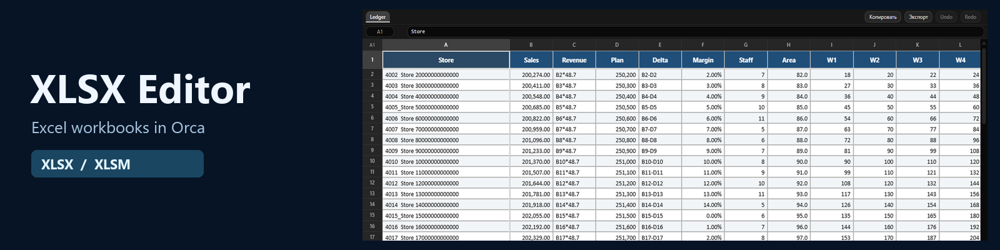
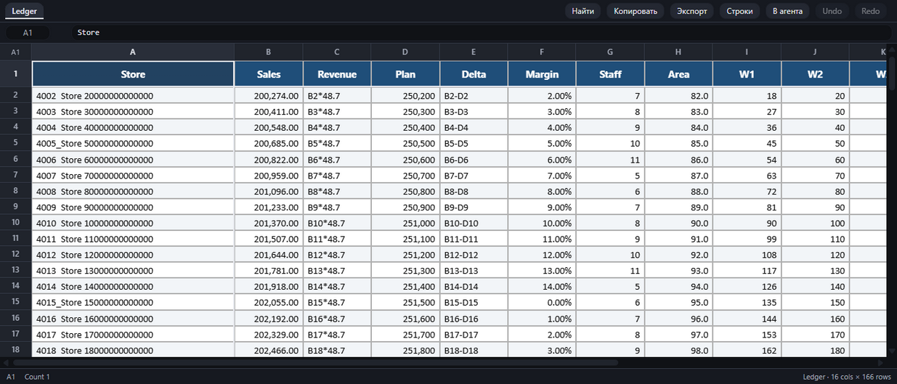

<div align="center">

[English version](README.en.md)



<p>
  <a href="https://github.com/narimanisakhanov-creator/orca-xlsx-editor/releases/latest"></a>
  <a href="LICENSE"></a>
  
  
  
</p>

<p><b>Редактор книг Excel в Orca: форматирование из файла, точечное редактирование и сохранение нетронутых частей ZIP.</b></p>

<p>
  <a href="#установка">Установка</a> ·
  <a href="#возможности">Возможности</a> ·
  <a href="#передать-агенту">Передать агенту</a> ·
  <a href="#доступ-и-безопасность">Доступ</a> ·
  <a href="#как-сохраняет">Как сохраняет</a> ·
  <a href="#ограничения">Ограничения</a> ·
  <a href="#разработка">Разработка</a> ·
  <a href="#изменения">Изменения</a>
</p>

</div>

---



<p align="center"><sub>Реальный снимок Orca, полученный на синтетической книге <code>test/fixtures/styled.xlsx</code>; происхождение описано в <a href="docs/screenshots.md">docs/screenshots.md</a>.</sub></p>

## Установка

**Из Git.** Откройте ссылку в Orca:

<a href="orca://plugins/narimanisakhanov-creator.xlsx-editor?catalog=https://github.com/narimanisakhanov-creator/orca-xlsx-editor.git">Установить из Git</a>

**Режим разработки.** Из корня клонированного репозитория выполните:

```sh
orca plugin dev load .
```

Требуется Orca `>=1.4.248`. Node.js `>=20.6` нужен для сборки и тестов.

## Возможности

- Открывает `.xlsx` и `.xlsm`, включая все листы книги.
- Рисует заливки, шрифты, границы, выравнивание, числовые форматы, объединённые ячейки, закреплённые области, ширины столбцов и высоты строк.
- Редактирует значения ячеек и их типы, поддерживает формулы, очистку, вставку блока, отмену и повтор.
- Вставляет и удаляет целые строки и столбцы. Формулы на всех листах, именованные диапазоны, объединения, таблицы, рисунки, фильтры и геометрия столбцов переводятся одной транзакцией; неподдерживаемая ссылка или объект отменяет всю операцию. Undo и redo работают и после сохранения.
- Ищет по значениям и формулам всех листов (`Найти`, Ctrl+F), с переходом к совпадению и явным продолжением неполной страницы.
- Копирует выделение как TSV, CSV, Markdown или HTML с форматированием; экспортирует лист целиком.
- После правки, undo или redo помечает формулы и сообщает, что сохранённые результаты могут быть устаревшими: редактор формулы не пересчитывает.
- Передаёт таблицу агенту в терминал Orca — кнопкой, с предпросмотром; текст сверх лимита сообщения не отправляется.
- При сохранении оставляет нетронутыми макросы, рисунки, графики и сводные кэши; объекты, которые редактор не рисует, всё равно сохраняются.
- Работает локально и не обращается к сети.

## Передать агенту

Кнопка **В агента** в панели редактора собирает выделение (или активную ячейку) в Markdown-таблицу
или TSV и вставляет её в терминал выбранного агента текущего workspace. Отправка — только по
нажатию; по умолчанию текст вставляется **без** Enter, чтобы его можно было прочитать и дополнить,
а галочка «Отправить сразу (Enter)» отправляет то же сообщение с Enter.

Для текста, который можно отправить, предпросмотр показывает ровно то, что уйдёт. Передача — это
**одно** сообщение `terminal.sendText` не длиннее 4096 символов (ограничение Orca). Текст длиннее
лимита не делится и не обрезается: передача отменяется, ничего не отправляется. Кнопка
«Скопировать полный текст» предлагает копирование для ручной вставки. Выделение больше 200 000
ячеек нельзя ни отправить, ни скопировать этим способом. Кроме того, перед копированием действует
консервативная оценка размера: максимум 8 × 1024 × 1024 кодовых единиц UTF-16 с запасом для
заголовка; она может отклонить и меньший итоговый текст. При превышении лимита ничего не копируется:
уменьшите выделение. Плагин не повторяет отправку сам; при неизвестном исходе (например, таймауте)
проверьте терминал перед повторной отправкой.

Для этого плагин работает в профиле `trusted-worker` и просит два разрешения при включении:
`agent:read` — увидеть агентов workspace, `terminal:send` — ввести текст в один терминал. Новых
разрешений передача не добавляет.

## Доступ и безопасность

Редактор работает в песочнице: рисует книгу, получает байты и отдаёт новые. Пути к файлу он не знает, файловой системы и сети у него нет.

Кнопке «В агента» нужны два API Orca, которые кадр вызвать не может, поэтому у плагина есть Node-воркер и два разрешения:

- `agent:read` — `agents.list`, чтобы показать список агентов текущего workspace;
- `terminal:send` — `terminal.sendText`, чтобы вписать выбранный текст в выбранный терминал.

Оба вызова живут только в `worker/main.js`, только в двух обработчиках и только после нажатия. По
умолчанию текст вставляется без Enter; Enter отправляется вместе с сообщением только при
включённой галочке. Передача — одно сообщение не длиннее лимита Orca в 4096 символов, и ничего не
отправляется само — ни по таймеру, ни по событию. Подробнее: [SECURITY.md](SECURITY.md).

## Как сохраняет

Книга Excel — это ZIP с XML-частями; редактор меняет только элементы `<c>` в XML изменённых листов. Нетронутые записи ZIP копируются с исходными сжатыми байтами, а текстовые значения пишутся inline, поэтому `sharedStrings.xml` не переписывается. Макросы и остальные не затронутые части остаются байт-в-байт прежними. Если ячейка действительно изменилась и в книге есть `calcChain.xml`, цепочка удаляется, связи обновляются, а `fullCalcOnLoad="1"` просит Excel пересчитать книгу; сохранение без изменения ячеек не трогает эту служебную часть.

Чтобы открыть больше реальных файлов, ExcelJS получает **отдельную копию только для чтения**: в ней сняты префиксы пространств имён и их объявления, удалены части `xl/drawings/*` (кроме `.vml`) и `xl/tables/*`, из XML листа убраны ссылки `<drawing>` и `<tableParts>`, а цели связей листа приведены к путям относительно листа (включая абсолютные и пути с сегментами `.`/`..`). Эта копия живёт в памяти и никогда не записывается; в основе сохранения — исходные записи ZIP принятого файла плюс правки ячеек. Если на листе есть правила условного форматирования, над сеткой появляется предупреждение: они сохраняются, но не отображаются. Это не значит, что теперь открывается любая книга: файл, который ExcelJS не разбирает по другой причине, по-прежнему не откроется, и редактор покажет ошибку.

## Ограничения

- Графики, сводные таблицы, спарклайны и другие drawing-объекты не рисуются; при сохранении они остаются в книге.
- Формулы не вычисляются: показывается сохранённый результат или текст формулы, а изменённая формула отдаётся Excel на пересчёт при открытии.
- Вставка и удаление строк и столбцов работают только там, где зависимости можно безопасно переписать. Книга с защитой листа, расширениями, неподдерживаемой формулой (например, `INDIRECT`, `OFFSET`, 3D- или внешние ссылки), графиком или неразрешимой связью объекта получает отказ целиком: частичных изменений не бывает. Цепочка вычислений после структурной правки удаляется, Excel пересчитает книгу при открытии.
- Копирование с форматированием ограничено 250 000 ячеек, 8 МиБ HTML и пределами браузера на объединённые ячейки; при отказе можно скопировать те же данные как TSV.
- Поддерживаются только `.xlsx` и `.xlsm`; `.xls`, `.xlsb` и `.ods` не поддерживаются.
- Условное форматирование сохраняется, но не отображается; при открытии такой книги над сеткой появляется предупреждение.
- Совместимость чтения обходит известные ограничения ExcelJS на копии в памяти: снятие префиксов и объявлений пространств имён, удаление частей `xl/drawings/*` (кроме `.vml`) и `xl/tables/*` и ссылок на них, нормализация целей связей. Книга, которую ExcelJS не разбирает по другой причине, не откроется; универсального открытия любых книг нет.
- Сетевого доступа нет: редактор не загружает внешние ресурсы.
- Передача агенту работает только в desktop-приложении: в браузерном клиенте кадр не имеет доступа
  к воркеру.

## Разработка

```sh
npm ci
npm run build
npm test
npm run check:dist
orca plugin validate .
orca plugin check .
orca plugin test .
```

`npm test` запускает тесты Node.js. `npm run build` собирает содержимое `editor/assets/` и проверяет итоговый дистрибутив; `check:dist` повторяет проверки без записи. Команды `orca plugin validate`, `check` и `test` проверяют манифест, упаковку и тесты средствами Orca.

Тестовые книги не лежат в репозитории: в публичном репозитории плагина нет бинарных файлов, этого требует каталог Orca. `rich.xlsx`, `macro.xlsm` и `styled.xlsx` собирает `test/helpers/build-fixtures.mjs` из обычных OOXML-строк, а `fflate` упаковывает их в ZIP; тест получает книгу через `test/helpers/fixtures.mjs`, который при первом обращении создаёт файлы. Поэтому `git clone && npm ci && npm test` работает без подготовки и без Python, а сборка детерминирована: у записей ZIP фиксированное время, и два прогона дают побайтово одинаковые книги. Пересобрать книги вручную можно командой `node test/helpers/build-fixtures.mjs`; каталог `test/fixtures/` с книгами добавлен в `.gitignore`.

Порядок релиза: `orca plugin release-entry` читает **закоммиченный HEAD**, а не рабочее дерево, и `orca-catalog.json` входит в хешируемое содержимое. Сначала соберите и проверьте всё содержимое плагина, включая имеющийся каталог, закоммитьте его как **commit A** и поставьте тег на A. Затем на чистом дереве с A выполните `node scripts/write-catalog.mjs`: новая запись получит `commit` и `contentHash` коммита A. Закоммитьте полученный каталог отдельным **commit B**. Байты каталога в A входят в его хеш; не добавляйте новую запись в A через amend, не переносите тег и не перепиновывайте запись на B — это создаст самоссылку.

## Изменения

- [Журнал изменений](CHANGELOG.md)
- [Безопасность и доступы](SECURITY.md)
- [Лицензия MIT](LICENSE)
- [Уведомления о стороннем коде](THIRD_PARTY_NOTICES.md)
- [English version](README.en.md)
